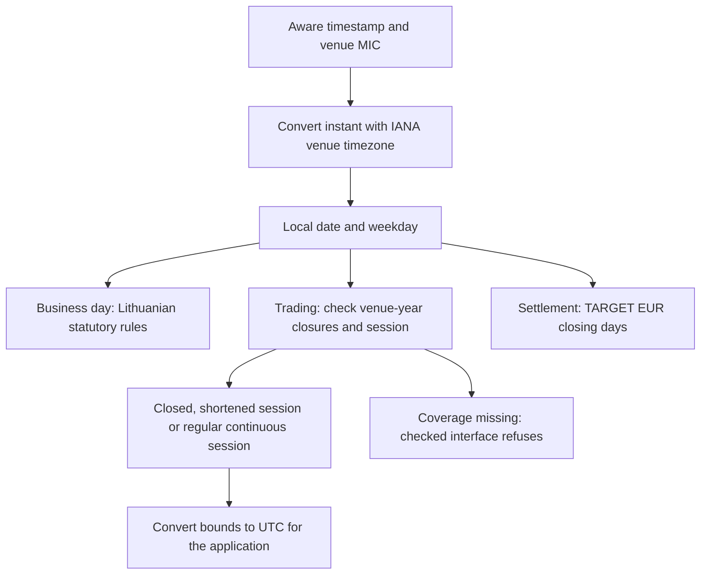
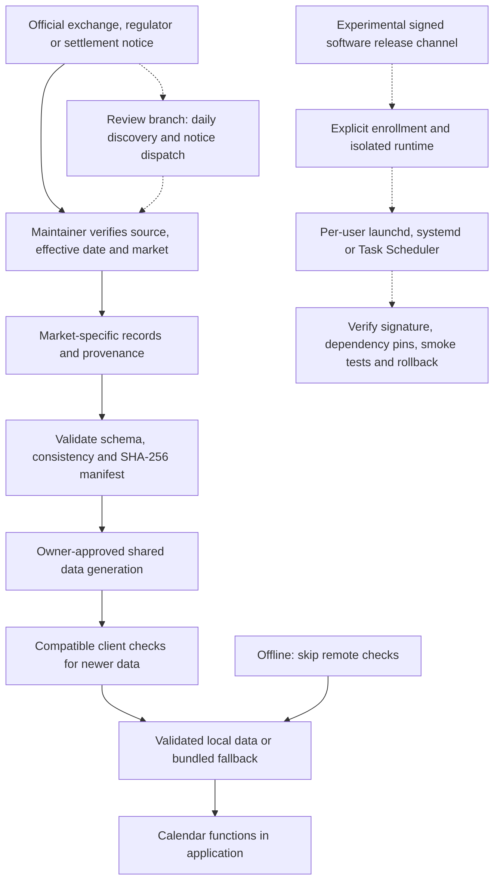

# AION Lithuanian Market Calendar

[Lietuviškai](README.lt.md) | [PyPI 1.2.1](https://pypi.org/project/aion-lithuanian-market-calendar/1.2.1/) | [Product page](https://aionanalytics.in/open-source/lithuanian-market-calendar) | [Report a calendar error](https://github.com/AION-Analytics-India/aion-lithuanian-market-calendar/issues)

Use this MIT-licensed Python library to answer three different questions: is this a Lithuanian business day, is a venue in its continuous trading session, and is this a TARGET euro settlement day? They can have three different answers. No hosted API, trading account or API key is required.

**Published: 1.2.1. Candidate: 1.3.0, not released.** The published wheel's bundled Baltic table incorrectly treats 31 December 2026 as an early close. Nasdaq lists Vilnius, Riga and Tallinn as closed. It also lists 18 November as closed in Riga only. The candidate corrects the 2026 venue lists. Until the reviewed data is published, check the [exchange table](https://www.nasdaqbaltic.com/statistics/en/calendar?holidays=1) for schedule-critical work. A manifest hash verifies bytes; it cannot establish that the market dates are correct.

## Install and use

```bash
python -m pip install --upgrade aion-lithuanian-market-calendar
python -c "from importlib.metadata import version; print(version('aion-lithuanian-market-calendar'))"
```

Run these commands in the environment that runs your application. Python 3.10 or later is required; the candidate test matrix spans 3.10 to 3.14. On Windows the library depends on tzdata. On other platforms it uses the system IANA database.

```python
from datetime import date, datetime, timezone
from aion_lithuanian_market_calendar import (
    data_status, holidays, is_business_day, is_settlement_day,
    is_open, session_bounds_utc, get_market_phase,
)
assert is_business_day("2026-04-03") and not is_settlement_day("2026-04-03")
assert not is_business_day("2026-02-16") and is_settlement_day("2026-02-16")
names = [(h.name_en, h.name_lt) for h in holidays(2026)]
instant = datetime(2026, 7, 1, 9, tzinfo=timezone.utc)
print(data_status(), session_bounds_utc(date(2026, 7, 1), "XVIL"))
print(is_open(instant, "XVIL"), get_market_phase(instant, "XVIL"))
```

## Holidays, payments and session rules

Under [Lithuanian Labour Code Article 123](https://e-seimas.lrs.lt/portal/legalAct/lt/TAD/10c6bfd07bd511e6a0f68fd135e6f40c/asr), the library computes 16 statutory holiday entries: 12 fixed dates, Western Gregorian Easter Sunday and Monday, and Mother's and Father's Days on the first Sundays of May and June. Names are available in English and Lithuanian. No automatic substitute Monday. December 24 is a statutory holiday, not an early close.

Good Friday illustrates why payroll, venue scheduling and payments need different calendars: it can be a Lithuanian business day while Nasdaq Baltic and TARGET EUR are closed. On February 16 offices can close while TARGET settles. For bank-holiday and SEPA settlement-day calculations, confirm the payment scheme, currency, participant and cutoff. This API models the standard euro TARGET closing-day rule, not instant payments, all T2S currencies or an individual bank's cutoffs. See the [ECB's starred TARGET dates](https://www.ecb.europa.eu/ecb/contacts/working-hours/html/index.en.html).

## Venues and time

The 19 venue definitions below implement scheduled **continuous trading** only. These hours are configuration, not a guarantee that every closure, interruption or auction is covered. For 2026 the candidate has an explicit source review for full-day closures in the three Baltic markets. Other venue holiday schedules are **not fully verified**. The 1.2.1 fallbacks can apply Baltic data to unrelated venues or report ordinary weekday hours for unknown years. Do not use those answers as confirmation that a market is open. The candidate adds `checked_session_bounds_utc(day, venue)` to refuse venue-years without evidence; it does not retroactively fix 1.2.1.

| MIC | Venue | IANA zone | Local session |
| --- | --- | --- | --- |
| ASEX | Athens Stock Exchange | Europe/Athens | 10:15-17:20 |
| XAMS | Euronext Amsterdam | Europe/Amsterdam | 09:00-17:30 |
| XBRU | Euronext Brussels | Europe/Brussels | 09:00-17:30 |
| XBUD | Budapest Stock Exchange | Europe/Budapest | 09:00-17:00 |
| XCSE | Nasdaq Copenhagen | Europe/Copenhagen | 09:00-16:55 |
| XDUB | Euronext Dublin | Europe/Dublin | 08:00-16:30 |
| XETR | Xetra (Deutsche Boerse) | Europe/Berlin | 09:00-17:30 |
| XHEL | Nasdaq Helsinki | Europe/Helsinki | 10:00-18:25 |
| XLIS | Euronext Lisbon | Europe/Lisbon | 08:00-16:30 |
| XMAD | Bolsa de Madrid (BME) | Europe/Madrid | 09:00-17:30 |
| XMIL | Euronext Milan | Europe/Rome | 09:00-17:30 |
| XPAR | Euronext Paris | Europe/Paris | 09:00-17:30 |
| XPRA | Prague Stock Exchange | Europe/Prague | 09:00-16:20 |
| XRIS | Nasdaq Riga | Europe/Riga | 10:00-15:55 |
| XSTO | Nasdaq Stockholm | Europe/Stockholm | 09:00-17:25 |
| XTAL | Nasdaq Tallinn | Europe/Tallinn | 10:00-15:55 |
| XVIL | Nasdaq Vilnius | Europe/Vilnius | 10:00-15:55 |
| XWAR | Warsaw Stock Exchange (GPW) | Europe/Warsaw | 09:00-17:00 |
| XWBO | Wiener Boerse | Europe/Vienna | 09:00-17:30 |

Use timezone-aware datetimes. The same instant in UTC and Europe/Vilnius identifies the same session: ordinary Vilnius opening is 08:00 UTC in winter and 07:00 UTC in summer. Europe/Dublin has its own IANA DST behavior. Apply early closes only to their stated venue, year and market. Opening/closing auctions, pre-open and post-trading phases are not modeled. In 1.2.1, `is_open` includes the closing instant while `get_market_phase` excludes it; do not interchange them at that instant.



## Where data and software come from



The [shared data repository](https://github.com/AION-Analytics-India/aion-market-calendar-data) owns exchange data. Format: dated holiday lists and optional venue-specific closing times, distinct from India's event/policy records. The public schema-1 manifest has SHA-256 hashes, not a digital signature. New approved compatible data can reach an installed wheel without a Python upgrade. The client checks data on first use, throttled by its local cache; it does not poll every exchange. Failure falls back to verified cached/bundled data or reports rule-only mode. Inspect `data_status()` before depending on the answer. Set `AION_LT_CALENDAR_OFFLINE=1` **before import** for no network. Use `refresh_data(force=True)` to request a check. Neither first-use data refresh nor an unchanged source page proves a daily official-source ingestion run. The daily discovery workflow is under review; no automatic approval.

### Software updates and platform evidence

A normal pip install has no scheduler. Existing users must upgrade manually. **Production unattended updates are not activated.** Candidate notification-only enrollment, signed compatible-patch installation and isolated application launch share a pinned controller. Only enrolled applications using the managed interpreter change version; the original environment, already running code, customer pins and protected workloads remain under their owner's control.

| Platform | Calendar | Candidate managed scheduling |
| --- | --- | --- |
| Linux | Pure Python; IANA zone database | User systemd timer, usable user manager and venv/ensurepip required |
| macOS | Pure Python; IANA zone database | User launchd agent in the signed-in user session |
| Windows | Same wheel, tzdata dependency | Interactive user Task Scheduler; native Windows 10, Windows 11 x64 desktop and genuine reboot/logon acceptance remain separate |

See [review CI](https://github.com/AION-Analytics-India/aion-lithuanian-market-calendar/actions) and [candidate enrollment instructions](docs/UPDATES.md) for tested scope. A simulated service restart is not an OS reboot. No production signing root or release channel is approved. No identifying telemetry, package installation during import or network version check in calendar calculations.

## Developer references

Use the calendar as a Python market-session validator in a fintech application, to classify payroll dates, or to distinguish a closed exchange from an eligible euro settlement day. The library cannot execute orders or guarantee compliance. The issuing authority wins when its notice and the package differ.

Sources: [Nasdaq Baltic](https://www.nasdaqbaltic.com/statistics/en/calendar?holidays=1), [Nasdaq Nordic](https://www.nasdaq.com/european-market-activity/trading-hours), [Euronext](https://www.euronext.com/en/trading/trading-hours-holidays), [Xetra](https://www.cashmarket.deutsche-boerse.com/cash-en/trading/trading-calendar-and-trading-hours), [ECB](https://www.ecb.europa.eu/ecb/contacts/working-hours/html/index.en.html). For a correction, include the MIC, instrument or segment, date, timezone, package and dataset versions, expected result and official notice. Do not send customer records.

[Release history](CHANGELOG.md) | [Contributing](CONTRIBUTING.md) | [MIT licence](LICENSE) | [Previous 1.2.1 documentation](https://github.com/AION-Analytics-India/aion-lithuanian-market-calendar/blob/60c72ec5c9f88aea09f3f8a6fe73731102f2163e/README.md)
