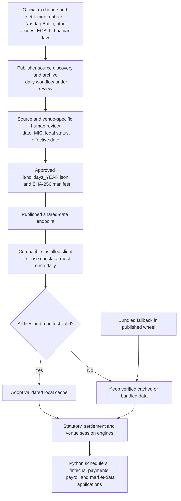
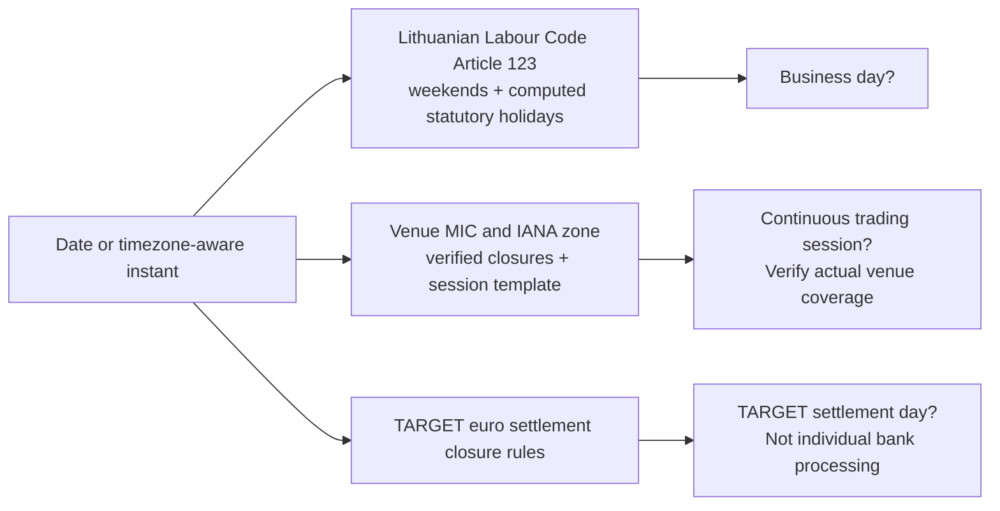
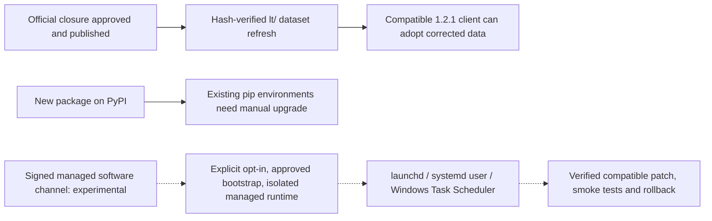

# aion-lithuanian-market-calendar

**Lithuanian and European market calendar. Local-time continuous-session templates
for 19 European venues, statutory Lithuanian holidays computed from law, and
maintained exchange-closure data that can refresh without a new wheel.**
A session template is not a verified holiday calendar for every venue.

**Lietuvos ir Europos rinkų kalendorius. Teisingos laiko juostos prekybos sesijos
19 ES biržų, apskaičiuotos Lietuvos šventės ir biržų švenčių duomenys, kurie
atsinaujina patys.**

[](https://pypi.org/project/aion-lithuanian-market-calendar/)
[-00D4FF)](https://aionanalytics.in/open-source/lithuanian-market-calendar)
[](https://pepy.tech/project/aion-lithuanian-market-calendar)
[](https://pypi.org/project/aion-lithuanian-market-calendar/)
[](LICENSE)

**[English](#english)** · **[Lietuviškai](#lietuviškai)**

**Official source and issues:** [AION-Analytics-India/aion-lithuanian-market-calendar](https://github.com/AION-Analytics-India/aion-lithuanian-market-calendar). This is an MIT-licensed Python library, not a hosted API; ordinary calendar functions need no AION login or API key. [Contribute a correction](CONTRIBUTING.md) · [Report a bug](https://github.com/AION-Analytics-India/aion-lithuanian-market-calendar/issues).

**Pradinis kodas ir klaidų pranešimai:** [AION-Analytics-India/aion-lithuanian-market-calendar](https://github.com/AION-Analytics-India/aion-lithuanian-market-calendar). Biblioteka platinama su MIT licencija; pagrindinėms kalendoriaus funkcijoms nereikia AION paskyros ar API rakto.

---

## Where this package lives · Kur rasti paketą

| | |
|---|---|
| PyPI | https://pypi.org/project/aion-lithuanian-market-calendar/ |
| Source and issues · Kodas ir klaidų pranešimai | https://github.com/AION-Analytics-India/aion-lithuanian-market-calendar |
| Changelog · Pakeitimų žurnalas | [`CHANGELOG.md`](https://github.com/AION-Analytics-India/aion-lithuanian-market-calendar/blob/main/CHANGELOG.md) |
| Product page · Produkto puslapis | https://aionanalytics.in/open-source/lithuanian-market-calendar |
| Holiday data it refreshes from · Duomenys, iš kurių atsinaujina | https://github.com/AION-Analytics-India/aion-market-calendar-data |
| AION community · AION bendruomenė | Telegram https://t.me/+VXWCiDgZjBI3ZjA1 · Discord https://discord.gg/Dk9Pjc9cVa |

Install only from PyPI · Diekite tik iš PyPI: `pip install aion-lithuanian-market-calendar`

## Published release: 1.3.0 (16 November 2026)

**[Install 1.3.0 from PyPI](https://pypi.org/project/aion-lithuanian-market-calendar/1.3.0/)** · **[GitHub v1.3.0 release and correction advisory](https://github.com/AION-Analytics-India/aion-lithuanian-market-calendar/releases/tag/v1.3.0)**

Version 1.3.0 bundles the reviewed Baltic data, adds `checked_session_bounds_utc` for verified venue-years, and prevents normal and forced refresh from replacing the selected generation with an older or conflicting one. It was published through the approved release workflow after [20/20 final CI jobs](https://github.com/AION-Analytics-India/aion-lithuanian-market-calendar/actions/runs/43779903364). The separate experimental software updater is **not production-activated**. Both Windows, macOS and Linux were exercised in the stated test environments; native Windows 10 and Windows 11 x64 desktop acceptance and real reboot/logon remain unverified.

We apologize for the incorrect dates in the bundled 1.2.1 data. The correction concerns exchange sessions; it does not change Lithuanian statutory holidays or TARGET settlement rules.

### Important: known 2026 Nasdaq Baltic calendar errors in 1.2.1

The published 1.2.1 wheel includes an outdated Baltic closure table. Before a verified corrected dataset has been adopted, **do not use 1.2.1's bundled answers as proof that a Baltic venue is open** on these dates:

| Date | Nasdaq Vilnius `XVIL` | Nasdaq Riga `XRIS` | Nasdaq Tallinn `XTAL` | Previously misleading bundled behaviour |
| --- | --- | --- | --- | --- |
| 2026-11-18 | No closure listed | **Closed** | No closure listed | Riga can be treated as an ordinary session |
| 2026-12-31 | **Closed all day** | **Closed all day** | **Closed all day** | Incorrect early close at 12:30 |

Source: [Nasdaq Baltic official trading-holiday calendar](https://www.nasdaqbaltic.com/statistics/en/calendar?holidays=1). A venue not listed as closed is **not** proof of real-time availability; actual trading can be affected by notices, outages and instrument rules.

The corrected [shared generation 2026.11.15.1](https://github.com/AION-Analytics-India/aion-market-calendar-data/commit/91651c8c50852e7e82adb9986e6aa49129787cda) is public. A clean 1.2.1 wheel downloaded it from the default endpoint, verified both year files, and read the corrected answers in a new interpreter. Check `data_status()["dataset_version"]` in your application. Offline copies may still use the bundled data. In 1.2.1, explicitly forcing refresh against an older source can reinstall older data. Do not use a stale mirror. Publishing data does not upgrade Python code.

### Check for software updates

Run these in the Python environment your application uses:

```sh
python -m pip list --outdated
python -m pip index versions aion-lithuanian-market-calendar
python -m pip install --upgrade aion-lithuanian-market-calendar
python -c "from importlib.metadata import version; print(version('aion-lithuanian-market-calendar'))"
```

pip does not automatically push package-specific upgrade notifications to every historical installer. Subscribe to the [PyPI release RSS feed](https://pypi.org/rss/project/aion-lithuanian-market-calendar/releases.xml) or use **Watch > Custom > Releases** on [GitHub](https://github.com/AION-Analytics-India/aion-lithuanian-market-calendar). Ordinary installations do not check software versions on import or during calculations. The [optional updater](https://github.com/AION-Analytics-India/aion-lithuanian-market-calendar/blob/main/docs/UPDATES.md) requires separate enrollment; its notification-only mode offers the installed/available versions, release notes and upgrade instructions, supports acknowledgement and offline mode, and has a CLI fallback.

**Lietuviškai (pataisų pranešimas):** Pagal [„Nasdaq Baltic“ oficialų prekybos kalendorių](https://www.nasdaqbaltic.com/statistics/en/calendar?holidays=1) 2026 m. lapkričio 18 d. iš trijų Baltijos biržų nedirba tik Ryga (`XRIS`), o gruodžio 31 d. prekyba nevyksta Vilniuje (`XVIL`), Rygoje (`XRIS`) ir Taline (`XTAL`). Kartu su 1.2.1 pateikti duomenys šiais atvejais gali klaidinti. Nauja lietuviška techninė redakcija laukia gimtakalbio finansų ir teisės terminijos peržiūros.

## First useful check · Pirmasis patikrinimas

```python
from aion_lithuanian_market_calendar import is_business_day, is_settlement_day

print(is_business_day("2026-04-03"))    # True: Good Friday is a business day in Lithuania
print(is_settlement_day("2026-04-03"))  # False: TARGET does not settle
```

No AION API credentials required. `pip install aion-lithuanian-market-calendar` installs the maintained release from PyPI.

## Previous release: 1.1.0 · Ankstesnė versija: 1.1.0

**Settlement days are not business days.** Euro settlement runs on TARGET (T2 and
T2S), which closes on New Year's Day, Good Friday, Easter Monday, 1 May, 25 and
26 December. That is a different list from Lithuania's public holidays: Good Friday
2026 is a business day in Lithuania with no euro settlement, and 16 February is a
settlement day although offices are shut. `is_settlement_day`, `next_settlement_day`
and `target_closing_days` answer it, computed for any year from 2002.

**Intraday phase.** `get_market_phase(at, venue)` returns `CONTINUOUS` or `CLOSED`,
with the same holiday, half-day and break rules as `is_open`. Auctions, pre-open and
post-trading are not modelled, because the published sources disagree on them.

**Atsiskaitymo dienos nėra darbo dienos.** Atsiskaitymai eurais vyksta per TARGET
(T2 ir T2S), kuri nedirba Naujųjų metų dieną, Didįjį penktadienį, Velykų antrąją
dieną, gegužės 1-ąją, gruodžio 25 ir 26 d. Tai kitas sąrašas nei Lietuvos šventės:
2026 m. Didysis penktadienis Lietuvoje yra darbo diena, bet atsiskaitymų eurais nėra,
o vasario 16-ąją įstaigos nedirba, tačiau TARGET atsiskaito. Tai nustato
`is_settlement_day`, `next_settlement_day` ir `target_closing_days` — apskaičiuojama
bet kuriems metams nuo 2002 m.

**Prekybos fazė.** `get_market_phase(at, venue)` grąžina `CONTINUOUS` (nepertraukiama
prekyba) arba `CLOSED` (prekyba nevyksta), taikant tas pačias švenčių, sutrumpintų
dienų ir pertraukų taisykles kaip `is_open`. Aukcionai, išankstinė prekyba ir prekyba
po uždarymo nemodeliuojami, nes skelbiami šaltiniai dėl jų nesutaria.

```python
from datetime import datetime
from zoneinfo import ZoneInfo
from aion_lithuanian_market_calendar import is_business_day, is_settlement_day, get_market_phase, phase_name

is_business_day("2026-04-03"), is_settlement_day("2026-04-03")   # (True, False): Good Friday · Didysis penktadienis
get_market_phase(datetime(2026, 10, 26, 12, 0, tzinfo=ZoneInfo("Europe/Vilnius")))   # "CONTINUOUS"
phase_name("CONTINUOUS", "lt")                                     # "Nepertraukiama prekyba"
```

Filtering a pandas DataFrame · Pandas DataFrame filtravimas (pandas is not a dependency · pandas nėra priklausomybė):

```python
import pandas as pd
from aion_lithuanian_market_calendar import is_trading_day, get_market_phase

df = pd.DataFrame({"close": range(4)}, index=pd.date_range("2026-12-23 12:00", periods=4, freq="D", tz="Europe/Vilnius"))
df = df[[is_trading_day(ts.date(), "XVIL") for ts in df.index]]   # drops 24-26 Dec · pašalina gruodžio 24-26 d.
df["phase"] = [get_market_phase(ts.to_pydatetime(), "XVIL") for ts in df.index]
```

Full detail · Išsamiau: [`CHANGELOG.md`](CHANGELOG.md).

## What changed in 1.0.0

Full detail in [`CHANGELOG.md`](CHANGELOG.md). First stable release, and it
**contains a correctness fix that changes answers**.

**`is_market_open` was wrong before 1.0.0.** It compared your wall clock against
the session window without converting timezones, so the same instant answered
differently depending on how it was written — correct in Lithuania, wrong
everywhere else. If you passed anything but Lithuanian local time, you were
getting wrong answers; if you compensated by shifting datetimes, remove that
workaround.

**19 European venues**, rules only — Nasdaq Baltic and Nordic, Euronext, Xetra,
Madrid, Vienna, Warsaw, Prague, Budapest, Athens. Under MiFID II passporting a
Lithuanian investor can trade any of them.

**Exchange holidays are now separate from public holidays.** Good Friday closes
Nasdaq Baltic and is not a Lithuanian public holiday; Christmas Eve is statutory
and so is a full closure, not an early close.

**Holiday data updates itself**, hash-verified, without a release. No telemetry,
no analytics, no identifiers.

```bash
pip install --upgrade aion-lithuanian-market-calendar
```


## System architecture · Sistemos architektūra

### Two separate workflows: source publishing and client refreshing

The library does not poll every exchange or autonomously approve a trading
holiday. Publisher-side source discovery, human adjudication, and data publication
are separate from the **installed library's at-most-daily refresh check**.



The publisher-side discovery workflow was demonstrated on a review branch, but
the [shared-data workflow](https://github.com/AION-Analytics-India/aion-market-calendar-data)
had **not yet passed a production scheduled discovery-to-approval-to-publication
trace**. Do not interpret its existence in a branch as a running production job.
No source-page fingerprint alone authorizes a trading-calendar change.

### Three independent calendar questions



**Lithuanian statutory holidays:** 16 holiday entries under Article 123,
including Western Easter Sunday/Monday, the first Sunday of May (Mother's Day),
the first Sunday of June (Father's Day), Christmas Eve and no substitute Monday.
Užgavėnės (Shrove Tuesday) is a traditional observance, not a statutory
non-working day.

**Trading vs settlement:** On 3 April 2026 (Good Friday), Lithuania has a
business day, but Nasdaq Baltic and TARGET are closed. On 16 February,
Lithuania observes a statutory holiday while TARGET can settle. TARGET T2/T2S
calendar rules are not an end-to-end SEPA or bank-specific settlement guarantee.
Venue MIC `XVIL`, `XRIS` and `XTAL` have different holiday dates.

**Timezones:** Always pass aware datetimes to `is_open`. Sessions are
configured in each venue's IANA local zone; `Europe/Vilnius` normally opens at
10:00 local, equivalent to 08:00 UTC in winter and 07:00 UTC in summer.
`Europe/Dublin` requires particular DST care. The library models scheduled
continuous trading, not auctions, pre-open, post-close, unscheduled halts or
broker execution permissions.

### Market sessions: 19 defined venues, not 19 verified holiday calendars

The times below are **local continuous-session templates from the published
`venues.py` definitions**, not proof of every listed venue's closure calendar
or real-time open status. Check actual venue announcements and years of coverage.

| MIC | Venue | Local IANA timezone | Ordinary continuous session |
| --- | --- | --- | --- |
| `XVIL` | Nasdaq Vilnius | Europe/Vilnius | 10:00-15:55 |
| `XRIS` | Nasdaq Riga | Europe/Riga | 10:00-15:55 |
| `XTAL` | Nasdaq Tallinn | Europe/Tallinn | 10:00-15:55 |
| `XSTO` | Nasdaq Stockholm | Europe/Stockholm | 09:00-17:25 |
| `XCSE` | Nasdaq Copenhagen | Europe/Copenhagen | 09:00-16:55 |
| `XHEL` | Nasdaq Helsinki | Europe/Helsinki | 10:00-18:25 |
| `XPAR` | Euronext Paris | Europe/Paris | 09:00-17:30 |
| `XAMS` | Euronext Amsterdam | Europe/Amsterdam | 09:00-17:30 |
| `XBRU` | Euronext Brussels | Europe/Brussels | 09:00-17:30 |
| `XLIS` | Euronext Lisbon | Europe/Lisbon | 08:00-16:30 |
| `XMIL` | Euronext Milan | Europe/Rome | 09:00-17:30 |
| `XDUB` | Euronext Dublin | Europe/Dublin | 08:00-16:30 |
| `XETR` | Xetra | Europe/Berlin | 09:00-17:30 |
| `XMAD` | Madrid | Europe/Madrid | 09:00-17:30 |
| `XWBO` | Vienna | Europe/Vienna | 09:00-17:30 |
| `XWAR` | Warsaw | Europe/Warsaw | 09:00-17:00 |
| `XPRA` | Prague | Europe/Prague | 09:00-16:20 |
| `XBUD` | Budapest | Europe/Budapest | 09:00-17:00 |
| `ASEX` | Athens | Europe/Athens | 10:15-17:20 |

### Calendar data refresh is NOT a Python software upgrade



Ordinary `pip install` registers **no auto-updater**. Version 1.2.1 contains
neither the experimental controller nor user-visible upgrade notifications.
Version 1.3.0 includes opted-in notification-only and managed
patch-update components; they passed disposable signed-channel tests but are
**not production-activated**. No production root key, approved
release channel or customer bootstrap is supplied. Existing applications do
not change interpreter automatically and already-running processes are not
restarted. PyPI does not notify every previous installer.

### Operating-system and release verification

The table summarizes the separately identified review run. Final artifact evidence is retained by the [verification workflow](https://github.com/AION-Analytics-India/aion-lithuanian-market-calendar/actions/workflows/verify-review.yml).

| Platform | Published 1.3.0 calendar library | Optional managed-updater test evidence, **not active in production** |
| --- | --- | --- |
| macOS | Python 3.10-3.14 wheel/sdist checks passed | Isolated user `launchd` lifecycle checks passed |
| Linux | Python 3.10-3.14 wheel/sdist checks passed | Isolated user `systemd` lifecycle checks passed |
| Windows | Pure-Python wheel with `tzdata` on Windows; tests passed on Windows Server x64 | Windows Server 2022 x64 and Windows 11 ARM64 running x64 Python passed isolated Task Scheduler tests; Windows 10 x64 and native Windows 11 x64 desktop acceptance unverified |

The **published 1.3.0 artifacts** passed [20/20 final CI jobs](https://github.com/AION-Analytics-India/aion-lithuanian-market-calendar/actions/runs/43779903364), with 30 wheel/sdist installations across Python 3.10-3.14 and 66 native updater-lifecycle checks in the tested environments. The isolated updater tests do **not** authorize production deployment. A real Windows reboot/logon, signed production release channel, trusted bootstrap and customer enrollment are still separate open gates. No auto-upgrade of ordinary pip installations is available.
[GitHub 1.3.0 release](https://github.com/AION-Analytics-India/aion-lithuanian-market-calendar/releases/tag/v1.3.0).

### Benefits and use cases

**Worldwide integration, defined European coverage:** Developers operating anywhere can use the library with timezone-aware inputs to evaluate Lithuanian statutory days, TARGET euro settlement dates and the 19 **specified European venue session templates**. This is **not** a calendar covering every stock exchange or every country worldwide. Verified complete 2026 closure coverage is explicitly limited to XVIL, XRIS and XTAL; other market calendars need their own primary-source verification.

- **Fintech and payments:** distinguish Lithuanian working days and TARGET
  euro settlement dates; support preliminary SEPA scheduling and financial
  reporting without claiming individual bank cutoffs.
- **Market infrastructure:** identify scheduled continuous windows for European
  venues using MIC identifiers and proper daylight-saving conversion.
- **Payroll and contracts:** compute the statutory Lithuanian non-working-day
  rules without annually shipping a new holiday table.
- **Historical data and research:** separate verified venue closures from
  missing bars, non-trading days and unknown coverage.
- **Offline deployments:** use bundled or validated cached data, with no API
  key, identity telemetry or hosted service dependency.

### Limitations and operational safeguards

- Only three Baltic markets received complete source review of **2026
  venue-specific full-day closures in the 1.3.0 bundle**. Other venue
  holiday lists and years are not equivalent to verified coverage.
- The old 1.2.1 **bundled** Baltic data had identified correctness defects; the public corrected dataset can refresh compatible clients, and 1.3.0 bundles the reviewed correction. An offline or force-refreshed 1.2.1 installation can remain stale. Public data repairs and PyPI software upgrades remain independent.
- `data_status()` is required to understand bundled, cached or rule-only
  data and dataset freshness; a calculated statutory holiday does not prove a
  venue is trading.
- This is not a live exchange-status API, trading-halt detector, broker
  interface, official CSD settlement schedule, tax/legal compliance opinion
  or guaranteed bank-processing calendar.
- Source observation, payload hashes and release approval are different trust
  steps. An integrity-valid file can still contain incorrect dates.
- The daily source-discovery/publisher pipeline and production unattended
  software installation must not be represented as operational before
  independent production receipts exist.

### References and developer discovery

[Official Nasdaq Baltic trading holidays](https://www.nasdaqbaltic.com/statistics/en/calendar?holidays=1)
· [ECB TARGET calendar](https://www.ecb.europa.eu/ecb/contacts/working-hours/html/index.en.html)
· [Lithuanian Labour Code Article 123](https://e-seimas.lrs.lt/portal/legalAct/lt/TAD/10c6bfd07bd511e6a0f68fd135e6f40c/asr)
· [Shared calendar datasets](https://github.com/AION-Analytics-India/aion-market-calendar-data)
· [Published 1.3.0 release](https://github.com/AION-Analytics-India/aion-lithuanian-market-calendar/releases/tag/v1.3.0)
· [Report a wrong trading date](https://github.com/AION-Analytics-India/aion-lithuanian-market-calendar/issues).

For package-specific calendar issues, contact **support@aionanalytics.in** or [file a public issue](https://github.com/AION-Analytics-India/aion-lithuanian-market-calendar/issues). Include the package and dataset versions, MIC, date/timezone, expected/actual answer and official exchange notice; do not share accounts or credentials.

Related queries: Lithuanian business-day Python library, Lithuania statutory
holidays, Nasdaq Vilnius trading hours, Nasdaq Riga trading holidays, Nasdaq
Tallinn session calendar, 2026 Baltic trading closures, TARGET T2 settlement
calendar, SEPA payment scheduling, European stock market sessions, MIC ISO 10383,
Europe/Vilnius DST, Europe/Dublin timezone, Lithuanian bank holidays, Lithuanian
payroll working days, European exchange calendar Python, hash-verified market
holiday data, offline Lithuanian calendar API.

---

## English

*Lietuviškai — [žemiau](#lietuviškai) / [README.lt.md](README.lt.md)*

```bash
pip install aion-lithuanian-market-calendar
```

```python
from aion_lithuanian_market_calendar import is_business_day, next_business_day, holiday_on

is_business_day()                       # is today a working day in Lithuania
is_business_day("2026-12-25")           # False
next_business_day("2026-12-24")         # date(2026, 12, 28)

holiday_on("2026-06-24")
# Holiday(date=2026-06-24, name_en='Day of Dew and St John (Midsummer)',
#         name_lt='Rasos ir Joninių diena')
```

No API key. Python standard library for the core rules, with the `tzdata` runtime dependency on Windows. Online refresh is optional and can be disabled.

### Trading sessions — read this if you upgraded from 0.x

```python
from datetime import datetime, timezone
from aion_lithuanian_market_calendar import is_open

is_open(datetime.now(timezone.utc))                      # Nasdaq Vilnius
is_open(datetime.now(timezone.utc), venue="XETRA")       # Frankfurt
is_open(datetime.now(timezone.utc), venue="XPAR")        # Euronext Paris
```

**Pass a timezone-aware datetime.** A naive one raises, on purpose — see below.

> ### ⚠ `is_market_open` was wrong before 1.0.0
>
> It compared your wall clock against 10:00–15:55 **without converting
> timezones**. The same instant returned different answers depending on how you
> expressed it:
>
> | the same moment, written three ways | 0.x | 1.0.0 |
> | --- | --- | --- |
> | `12:00 Europe/Vilnius` | ✅ True | ✅ True |
> | `09:00 UTC` | ❌ **False** | ✅ True |
> | `14:30 Asia/Kolkata` | ⚠️ True *by luck* | ✅ True |
>
> If you called it with anything other than Lithuanian local time, **you were
> getting wrong answers.** If you compensated by shifting your datetimes before
> calling, remove that workaround — it will now double-count.
>
> `is_market_open` still works and now converts correctly. New code should use
> `is_open`, which takes `venue=` and refuses naive datetimes instead of guessing
> what they meant.

### European venues

19 venues, rules only — session times, weekends and daylight saving. Identified
by MIC (ISO 10383), with friendly aliases.

| | |
| --- | --- |
| **Nasdaq Baltic** | `XVIL` Vilnius · `XRIS` Riga · `XTAL` Tallinn |
| **Nasdaq Nordic** | `XSTO` Stockholm · `XCSE` Copenhagen · `XHEL` Helsinki |
| **Euronext** | `XPAR` Paris · `XAMS` Amsterdam · `XBRU` Brussels · `XLIS` Lisbon · `XMIL` Milan · `XDUB` Dublin |
| **Deutsche Börse** | `XETR` Xetra *(alias `XETRA`, `Frankfurt`)* |
| **Others** | `XMAD` Madrid · `XWBO` Vienna · `XWAR` Warsaw · `XPRA` Prague · `XBUD` Budapest · `ASEX` Athens |

Under MiFID II passporting a Lithuanian investor can trade any EU venue, so a
calendar scoped to Vilnius alone is incomplete for its own users.

Daylight saving is handled by `zoneinfo`. **No UTC offset is written down
anywhere in this package** — an offset in source code is wrong twice a year, and
CI fails the build if one appears.

From 1.2.0, `is_daylight_saving(day, venue)` reports the zone's state and
`session_bounds_utc(day, venue)` gives the session as UTC datetimes:

```python
from datetime import date
from aion_lithuanian_market_calendar import is_daylight_saving, session_bounds_utc

is_daylight_saving(date(2026, 3, 30), "XVIL")  # True
session_bounds_utc(date(2026, 3, 30), "XVIL")  # 07:00 to 12:55 UTC; 08:00 to 13:55 on 27 March
```

### Holidays that update themselves

**Statutory holidays are computed by rule; exchange closures require maintained data.** You normally do not need a package release for an updated exchange closure, because supported installations can refresh verified calendar data. Code changes and new interfaces may still require a package upgrade.

Lithuanian *public* holidays are computed — twelve fixed dates, two from the
Easter computus, two from a first-Sunday rule — so they can be computed offline for years to which those statutory rules apply. A change in the law requires a rule update.

*Exchange* holidays are different. A venue closes when it says it closes, and a
government can declare a day of mourning with a week's notice. Nothing derives
them, so they live in maintained JSON with a SHA-256 manifest (**not a digital signature**), and compatible clients can refresh that data:

- On first use, at most once a day, the library compares its manifest against a
  published one.
- If the remote is newer **and every file matches its SHA-256**, the update is
  cached under `~/.cache/aion_lt_calendar/` and used from then on.
- If anything at all goes wrong — offline, proxy, DNS, a host serving nonsense,
  a hash that does not match — it retains the last verified cache or bundled fallback. Validate `data_status()` and venue-year coverage
  before using an answer in a schedule-critical system.

```python
from aion_lithuanian_market_calendar import data_status, refresh_data

status = data_status()
print(status["source"], status["dataset_version"], status["rule_only"])

refresh_data(force=True)     # check now rather than waiting for the daily check
```

**Check `rule_only` before trusting an exchange-holiday answer.** True means no
verified data loaded: weekends and computed public holidays still apply, but
exchange closures are unknown. The library says so rather than guessing, because
an invented closure makes a scheduler skip a real trading day.

For offline calendar data, set `AION_LT_CALENDAR_OFFLINE=1` before calling the library. An independently enrolled experimental software supervisor has its own offline control.
Self-hosting the data? `AION_LT_CALENDAR_URL=https://your.host/path`.

### Exchange holidays are not public holidays

They overlap but they are not the same list, and conflating them is the commonest
way to get this wrong:

| | |
| --- | --- |
| **Good Friday** | Nasdaq Baltic closes. **Not** a Lithuanian public holiday. |
| **Christmas Eve** | A Lithuanian statutory holiday (Šv. Kūčios) — a full closure, not an early close. |
| **31 December 2026** | Nasdaq's 2026 calendar lists a **full trading holiday** for Vilnius, Riga and Tallinn; the early-close record in the bundled 1.2.1 dataset is incorrect. The statutory business-day status is a separate question. |

```python
from datetime import date
from aion_lithuanian_market_calendar import store

store.is_exchange_holiday(date(2026, 4, 3))       # True  — Good Friday
store.is_public_holiday_listed(date(2026, 4, 3))  # False — not a public holiday
# Do not rely on 1.2.1's bundled 2026-12-31 half-day record.
# Nasdaq Baltic declares a full trading holiday for XVIL, XRIS and XTAL.
```

### What it is for

Anything that has to answer *"was that a working day in Lithuania?"* and get the
same answer every time.

- **Payments and settlement.** Value dates, SEPA cut-offs, T+2, invoice due
  dates and late-payment interest all count working days. Lithuania is the
  largest EMI and payment-institution licensing hub in the EU, so a great deal
  of European payment infrastructure settles on the Lithuanian working calendar
  specifically.
- **Payroll and HR.** Time sheets, leave accrual, notice periods and overtime
  premiums are all defined against *šventės*. Getting 6 July wrong is a payroll
  error, not a cosmetic one.
- **Market data and trading.** Nasdaq Vilnius session checks, bar alignment,
  gap detection, and backtests that must not treat a holiday as a missing day.
- **Scheduling and SLA.** "Three business days" in a support contract, a batch
  job that must not fire on a holiday, a reminder that should land on a day
  someone is actually at work.
- **Reporting deadlines.** Regulatory and tax filings that shift when the due
  date is not a working day.

### How it helps

**Statutory holidays are computed, not shipped as a yearly table.** Lithuanian legal non-working days follow calendar rules, including fixed dates, Easter and first-Sunday observances. Those calculations work offline for supported years without fetching a holiday API.

**Exchange closures are separate from statutory holidays.** Market-specific closures and unscheduled changes cannot all be derived from Lithuanian law. Like our [Indian calendar](https://pypi.org/project/aion-indian-market-calendar/), this package uses maintained exchange data with a hash-verified refresh contract.

**Offline-capable, not permanently network-free.** For ordinary calendar operations the package can use bundled or verified cached data. Supported online installations may check for updated manifests (at most daily, under the documented refresh contract). Set `AION_LT_CALENDAR_OFFLINE=1` in air-gapped environments to disable network refreshes. No AION account or API key is required.

**It is bilingual, so it can reach the user interface.** Every holiday carries
both `name_en` and `name_lt` in the wording of the Labour Code, so a Lithuanian
customer sees `Rasos ir Joninių diena` rather than a translation someone
improvised.

**Easter uses the Gregorian (Western) computus.** Lithuania is predominantly
Catholic and observes Western Easter, not the Orthodox date. Getting this wrong
misplaces two holidays every year — this is the single most common bug in
hand-rolled European holiday code.

**It refuses to guess.** Where the law is silent the package does not invent a
rule, and where popular calendars disagree with the statute it follows the
statute and says so, out loud, below.

### The sixteen statutory holidays

Names follow **article 123 of the Labour Code** (*Darbo kodeksas, 123 straipsnis
„Švenčių dienos"*) in nominative form. Article 123 lists fourteen provisions;
two of them cover two calendar days each — Easter Sunday together with Easter
Monday, and 25 with 26 December — which is why sixteen dates fall out of
fourteen provisions.

| Date | English | Lietuviškai |
|---|---|---|
| 1 January | New Year's Day | Naujieji metai |
| 16 February | Day of Restoration of the State of Lithuania | Lietuvos valstybės atkūrimo diena |
| 11 March | Day of Restoration of Independence of Lithuania | Lietuvos nepriklausomybės atkūrimo diena |
| *moveable* | Easter Sunday | Šv. Velykos |
| *moveable* | Easter Monday | Velykų antroji diena |
| 1 May | International Labour Day | Tarptautinė darbo diena |
| *first Sunday of May* | Mother's Day | Motinos diena |
| *first Sunday of June* | Father's Day | Tėvo diena |
| 24 June | Day of Dew and St John (Midsummer) | Rasos ir Joninių diena |
| 6 July | Statehood Day and Day of the National Anthem | Valstybės (Lietuvos karaliaus Mindaugo karūnavimo) ir Tautiškos giesmės diena |
| 15 August | Assumption Day | Žolinė (Švč. Mergelės Marijos ėmimo į dangų diena) |
| 1 November | All Saints' Day | Visų Šventųjų diena |
| 2 November | Day of Remembrance of the Dead (All Souls' Day) | Mirusiųjų atminimo (Vėlinių) diena |
| 24 December | Christmas Eve | Šv. Kūčios |
| 25 December | Christmas Day | Šv. Kalėdos |
| 26 December | Second Day of Christmas | Šv. Kalėdų antroji diena |

**No substitute days.** Lithuania does not move a holiday that falls on a
weekend to the following Monday. Assumption Day on Saturday 15 August 2026 is
simply absorbed, and the Monday after is an ordinary working day.

### Užgavėnės is not a day off

Several Lithuanian calendar and accounting websites publish a *„nedarbo dienos"*
list of **seventeen** days for 2026, the extra entry being **Užgavėnės** (Shrove
Tuesday, 17 February 2026).

Užgavėnės does not appear in article 123. It is a traditional pre-Lent
celebration and an **ordinary working day**. Treating it as a day off would
shift every downstream settlement and payroll date that crosses it.

Because a caller comparing this package against a printed wall calendar would
otherwise think a day were missing, it is exposed explicitly — and separately:

```python
from aion_lithuanian_market_calendar import observances, is_business_day

observances(2026)
# (Observance(date=2026-02-17, name_en='Shrove Tuesday (Carnival)',
#             name_lt='Užgavėnės'),)

is_business_day("2026-02-17")   # True — it is a working day
```

`observances()` never affects `is_business_day`, `is_market_open`, or any other
business-day arithmetic. The test suite asserts that separation for every year
from 2024 to 2040.

### API

```python
is_business_day(when=None)          # working day for banks and offices
is_public_holiday(when=None)        # statutory non-working day
is_weekend(when=None)

next_business_day(after=None)
previous_business_day(before=None)
business_days_between(start, end)   # half-open interval

holidays(year)                      # all sixteen, ordered
holidays_between(start, end)        # half-open interval
holiday_on(day)                     # Holiday or None
observances(year)                   # traditional days that are NOT days off
easter_sunday(year)

is_market_open(at=None, market="XVIL")   # Nasdaq Vilnius
```

Dates accept `date`, `datetime`, an ISO string, or `None` for today.

```python
from aion_lithuanian_market_calendar import business_days_between, holidays_between

business_days_between("2026-12-20", "2027-01-05")   # 8
[h.name_en for h in holidays_between("2026-12-01", "2027-01-01")]
# ['Christmas Eve', 'Christmas Day', 'Second Day of Christmas']
```

### Scope

Covers the sixteen statutory **non-working** days (*šventės*) of article 123.

Lithuania also has commemorative and flag days (*atmintinos dienos*), which are
official but remain **working days**, so they do not change business-day
arithmetic and are out of scope here. Traditional celebrations are likewise not
days off; the one most often mistaken for one, Užgavėnės, is covered above.

Exchange session times are the one part of a market calendar that changes by
announcement rather than by rule. `is_market_open` uses standard Nasdaq Vilnius
continuous trading hours; confirm against the venue if you need intraday
precision.

A one-off national day of mourning declared by the Seimas cannot be derived by
definition and is out of scope. If you need one, layer it on top rather than
patching the computation.

### Verification

Easter is unit-tested against known dates for 2024, 2025, 2026, 2027, 2030 and
2035. Mother's Day and Father's Day are asserted to fall on a Sunday for every
year from 2024 to 2040. The full 2026 date list and every Lithuanian holiday
name are pinned in the test suite.

The holiday list and its Lithuanian spellings were checked against the text of
article 123 of the Labour Code, and independently reviewed by a Lithuanian
native speaker in September 2026. That review confirmed three things this
package had implemented but could not previously source:

- the list of sixteen is **complete**;
- Father's Day is the **first Sunday of June** (7 June 2026), not 1 June as one
  published source claimed — 1 June 2026 is a Monday;
- a holiday falling on a weekend gets **no replacement weekday**.

Version 0.1.1 corrected six Lithuanian names against the statutory wording,
most consequentially `Visų šventųjų` → **`Visų Šventųjų`** and the restoration
of `ir Tautiškos giesmės diena` to the 6 July name. No date changed.

Confirm against the Labour Code for any use with legal or financial
consequence. Corrections are welcome as issues — see
[CONTRIBUTING.md](CONTRIBUTING.md).

---

## Lietuviškai

*In English — [above](#english) / [README.md](README.md)*

```bash
pip install aion-lithuanian-market-calendar
```

```python
from aion_lithuanian_market_calendar import is_business_day, next_business_day, holiday_on

is_business_day()                       # ar šiandien darbo diena Lietuvoje
is_business_day("2026-12-25")           # False
next_business_day("2026-12-24")         # date(2026, 12, 28)

holiday_on("2026-06-24")
# Holiday(date=2026-06-24, name_en='Day of Dew and St John (Midsummer)',
#         name_lt='Rasos ir Joninių diena')
```

Nereikia API rakto. Nereikia interneto ryšio. Nereikia jokių nustatymų. Jokių
priklausomybių.

### Kam ji skirta

Bet kam, kas turi atsakyti į klausimą *„ar ta diena Lietuvoje buvo darbo
diena?"* ir kaskart gauti tą patį atsakymą.

- **Mokėjimai ir atsiskaitymai.** Valiutavimo datos, SEPA terminai, T+2,
  sąskaitų apmokėjimo terminai ir delspinigiai skaičiuojami darbo dienomis.
  Lietuva yra didžiausias elektroninių pinigų ir mokėjimo įstaigų licencijavimo
  centras ES, todėl labai didelė dalis Europos mokėjimų infrastruktūros
  atsiskaito būtent pagal Lietuvos darbo dienų kalendorių.
- **Darbo užmokestis ir personalas.** Darbo laiko apskaita, atostogų kaupimas,
  įspėjimo terminai ir priemokos už darbą švenčių dienomis remiasi *šventėmis*.
  Suklydus dėl liepos 6 d., tai jau ne kosmetinė, o atlyginimo klaida.
- **Rinkos duomenys ir prekyba.** Nasdaq Vilnius sesijų tikrinimas, duomenų
  eilučių derinimas, tarpų aptikimas ir istorinis testavimas, kuris neturi
  palaikyti šventės trūkstamais duomenimis.
- **Planavimas ir SLA.** „Trys darbo dienos" sutartyje, naktinė užduotis, kuri
  neturi pasileisti per šventę, priminimas, kuris turi pasiekti žmogų darbo
  metu.
- **Ataskaitų terminai.** Mokestinės ir priežiūros ataskaitos, kurių terminas
  keliasi, kai jis išpuola ne darbo dieną.

### Kuo ji naudinga

**Lietuvos šventinės nedarbo dienos apskaičiuojamos pagal teisines taisykles.**
Dvylika datų nustatytos, dvi priklauso nuo Velykų, o Motinos ir Tėvo dienos
yra pirmieji atitinkamų mėnesių sekmadieniai. Šių taisyklių skaičiavimui
nereikia kiekvienų metų biržos duomenų.

**Biržų nedarbo dienos yra atskiri, atnaujinami duomenys.** Jų negalima
automatiškai nustatyti vien pagal Lietuvos šventes. Biblioteka naudoja kartu
pateikiamus arba patikrintus vietinės talpyklos duomenis ir, jei leidžiama,
tikrina atnaujinimus. `AION_LT_CALENDAR_OFFLINE=1` išjungia tinklo užklausas.
Nereiškia, kad visų 19 prekybos vietų visų metų kalendoriai yra patikrinti.
Tą patį atskyrimą taiko [Indijos rinkos
kalendorius](https://pypi.org/project/aion-indian-market-calendar/).

**Ji dvikalbė, todėl tinka rodyti naudotojui.** Kiekviena šventė turi ir
`name_en`, ir `name_lt` pagal Darbo kodekso formuluotę, todėl lietuvis klientas
mato `Rasos ir Joninių diena`, o ne kieno nors susigalvotą vertimą.

**Velykos skaičiuojamos pagal Grigaliaus (Vakarų) kalendorių**, nes Lietuva yra
katalikiška šalis ir švenčia Vakarų, o ne stačiatikių Velykas. Suklydus čia,
kasmet nukryptų dvi šventės — tai dažniausia klaida pačių rašytame Europos
švenčių kode.

**Ji nespėlioja.** Kur įstatymas tyli, biblioteka taisyklės nesugalvoja, o kur
populiarūs kalendoriai nesutampa su įstatymu, ji laikosi įstatymo ir tai
pasako atvirai — žemiau.

### Šešiolika švenčių dienų

Pavadinimai pateikti pagal **Darbo kodekso 123 straipsnį** („Švenčių dienos"),
vardininko linksniu. 123 straipsnyje yra keturiolika punktų; du iš jų apima po
dvi kalendorines dienas — Velykų sekmadienį kartu su pirmadieniu ir gruodžio 25
kartu su 26 — todėl iš keturiolikos punktų susidaro šešiolika dienų.

| Data | Lietuviškai | English |
|---|---|---|
| Sausio 1 | Naujieji metai | New Year's Day |
| Vasario 16 | Lietuvos valstybės atkūrimo diena | Day of Restoration of the State of Lithuania |
| Kovo 11 | Lietuvos nepriklausomybės atkūrimo diena | Day of Restoration of Independence of Lithuania |
| *kintama* | Šv. Velykos | Easter Sunday |
| *kintama* | Velykų antroji diena | Easter Monday |
| Gegužės 1 | Tarptautinė darbo diena | International Labour Day |
| *pirmasis gegužės sekmadienis* | Motinos diena | Mother's Day |
| *pirmasis birželio sekmadienis* | Tėvo diena | Father's Day |
| Birželio 24 | Rasos ir Joninių diena | Day of Dew and St John (Midsummer) |
| Liepos 6 | Valstybės (Lietuvos karaliaus Mindaugo karūnavimo) ir Tautiškos giesmės diena | Statehood Day and Day of the National Anthem |
| Rugpjūčio 15 | Žolinė (Švč. Mergelės Marijos ėmimo į dangų diena) | Assumption Day |
| Lapkričio 1 | Visų Šventųjų diena | All Saints' Day |
| Lapkričio 2 | Mirusiųjų atminimo (Vėlinių) diena | Day of Remembrance of the Dead (All Souls' Day) |
| Gruodžio 24 | Šv. Kūčios | Christmas Eve |
| Gruodžio 25 | Šv. Kalėdos | Christmas Day |
| Gruodžio 26 | Šv. Kalėdų antroji diena | Second Day of Christmas |

**Šventės neperkeliamos.** Jei šventė sutampa su savaitgaliu, ji į pirmadienį
neperkeliama. Pavyzdžiui, Žolinė 2026 m. rugpjūčio 15 d. yra šeštadienis, o po
jos einantis pirmadienis — įprasta darbo diena.

### Užgavėnės nėra nedarbo diena

Kai kurios Lietuvos kalendorių ir buhalterinės apskaitos svetainės skelbia
**septyniolikos** „nedarbo dienų" sąrašą 2026 metams; papildomas įrašas yra
**Užgavėnės** (2026 m. vasario 17 d.).

Užgavėnių Darbo kodekso 123 straipsnyje nėra. Tai tradicinė šventė prieš
gavėnią ir **įprasta darbo diena**. Laikant ją nedarbo diena, pasislinktų visos
po jos einančios atsiskaitymų ir atlyginimų datos.

Kadangi lyginant šią biblioteką su sieniniu kalendoriumi galėtų pasirodyti, jog
vienos dienos trūksta, Užgavėnės pateikiamos atskirai:

```python
from aion_lithuanian_market_calendar import observances, is_business_day

observances(2026)
# (Observance(date=2026-02-17, name_en='Shrove Tuesday (Carnival)',
#             name_lt='Užgavėnės'),)

is_business_day("2026-02-17")   # True — tai darbo diena
```

`observances()` niekada neveikia `is_business_day`, `is_market_open` ar bet
kurio kito darbo dienų skaičiavimo. Testai tai tikrina kiekvieniems metams nuo
2024 iki 2040.

### Funkcijos

```python
is_business_day(when=None)          # darbo diena bankams ir įstaigoms
is_public_holiday(when=None)        # šventės diena
is_weekend(when=None)               # savaitgalis

next_business_day(after=None)       # kita darbo diena
previous_business_day(before=None)  # ankstesnė darbo diena
business_days_between(start, end)   # darbo dienų skaičius

holidays(year)                      # visos šešiolika
holidays_between(start, end)        # šventės nurodytu laikotarpiu
holiday_on(day)                     # Holiday arba None
observances(year)                   # tradicinės dienos, kurios NĖRA nedarbo dienos
easter_sunday(year)                 # Velykų sekmadienis

is_market_open(at=None, market="XVIL")   # Nasdaq Vilnius
```

Datos priimamos kaip `date`, `datetime`, ISO tekstas arba `None` (šiandien).

```python
from aion_lithuanian_market_calendar import business_days_between, holidays_between

business_days_between("2026-12-20", "2027-01-05")   # 8
[h.name_lt for h in holidays_between("2026-12-01", "2027-01-01")]
# ['Šv. Kūčios', 'Šv. Kalėdos', 'Šv. Kalėdų antroji diena']
```

### Apimtis

Apima šešiolika **nedarbo** dienų (*šventės*) pagal 123 straipsnį.

Lietuva taip pat turi **atmintinas dienas** ir vėliavos dienas. Jos yra
oficialios, bet lieka darbo dienomis, todėl darbo dienų skaičiavimo nekeičia ir
į šią biblioteką neįtrauktos. Tradicinės šventės taip pat nėra nedarbo dienos;
dažniausiai su jomis supainiojamos Užgavėnės aprašytos aukščiau.

Biržos prekybos valandos yra ta rinkos kalendoriaus dalis, kuri keičiasi ne
pagal taisyklę, o pagal pranešimą. `is_market_open` naudoja įprastas Nasdaq
Vilnius prekybos valandas; jei reikia tikslumo iki minutės, pasitikrinkite
biržoje.

Seimo paskelbta vienkartinė gedulo diena pagal apibrėžimą negali būti
apskaičiuota ir į biblioteką neįtraukta. Jei jos reikia, pridėkite ją atskirai,
o ne taisykite skaičiavimą.

### Patikra

Velykų data patikrinta 2024, 2025, 2026, 2027, 2030 ir 2035 metams. Motinos ir
Tėvo dienos patikrintos, kad visada būtų sekmadienis nuo 2024 iki 2040 metų.
Visas 2026 m. sąrašas ir visi lietuviški pavadinimai įrašyti į testus.

Švenčių sąrašas ir lietuviškos rašybos formos sutikrintos su Darbo kodekso 123
straipsnio tekstu ir atskirai peržiūrėtos gimtakalbio lietuvio 2026 m. rugsėjo
mėn. Ta peržiūra patvirtino tris dalykus, kurie bibliotekoje jau buvo
įgyvendinti, bet iki tol neturėjo šaltinio:

- šešiolikos dienų sąrašas yra **išsamus**;
- Tėvo diena yra **pirmasis birželio sekmadienis** (2026 m. birželio 7 d.), o ne
  birželio 1 d., kaip teigė vienas šaltinis — 2026 m. birželio 1 d. yra
  pirmadienis;
- su savaitgaliu sutampanti šventė **į kitą darbo dieną neperkeliama**.

0.1.1 versijoje pagal įstatymo formuluotę pataisyti šeši lietuviški pavadinimai;
svarbiausi — `Visų šventųjų` → **`Visų Šventųjų`** ir liepos 6 d. pavadinimui
grąžinta dalis `ir Tautiškos giesmės diena`. Nė viena data nepasikeitė.

Naudojant teisiniais ar finansiniais tikslais, datas rekomenduojame pasitikrinti
Darbo kodekse. Pastabas ir pataisymus mielai priimame — žr.
[CONTRIBUTING.md](CONTRIBUTING.md).

---


## Holiday data updates itself

**Approved new exchange-data generations can be picked up by compatible installed
packages without upgrading the Python wheel.** An official notice is not
automatically adopted until reviewed and published; the existing daily client
check is not proof of a complete daily upstream source-collector pipeline.

Holiday and closure data is published separately from the code, in
[`aion-market-calendar-data`](https://github.com/AION-Analytics-India/aion-market-calendar-data)
under [`lt/`](https://github.com/AION-Analytics-India/aion-market-calendar-data/tree/main/lt).
Every wheel bundles a copy as the fallback, and the library checks for a newer
one at most once a day.

An exchange closes when it announces it will, and a government can declare a day
of mourning at a week's notice. A library that could only learn about those
through a release would be quietly wrong for however long it took someone to
notice — and "quietly wrong" is the failure a calendar exists to prevent.

```bash
AION_LT_CALENDAR_OFFLINE=1        # disable all network access
AION_LT_CALENDAR_URL=https://…    # serve the data from somewhere else
AION_LT_CALENDAR_CACHE=/path      # where refreshed data is cached
```

The cache honours `XDG_CACHE_HOME`, and falls back to a temp directory if neither
that nor `~/.cache` is writable — losing the cache on reboot costs one extra
fetch and is better than silently never updating.

## Security

Every data file is verified against a SHA-256 listed in a **hash manifest, not a digitally signed manifest**. Hashes protect against mismatched downloaded files; they do not independently authenticate the publisher or establish whether exchange facts are correct.
Downloads land in a staging directory first; the swap into place happens **only
if every file verifies**, and it is atomic. One mismatch and nothing is adopted.

This is not ceremony. A refresh without integrity checking once wrote a
105-byte fragment over a 117 KB data file and wiped a production component. The
guard added at the time checked a size floor and a few expected keys, which only
stopped that particular malformed payload. SHA-256 checks detect payload mismatches
against the manifest, not malicious changes to both the payload and manifest.

If anything fails — offline, a proxy, DNS, a host serving nonsense, a hash that
does not match — the library keeps the bundled data, logs once, and carries on.
A failed refresh retains validated cached/bundled data when available; the caller
must still check coverage and freshness before taking an operational decision.

## Privacy

**No telemetry, no analytics, no identifiers.** The only outbound request this
package makes is fetching the holiday data described above, and it sends a
`User-Agent` naming the package and version — which every HTTP client sends — and
nothing else. No install id, no timestamp, no machine information.

Set `AION_LT_CALENDAR_OFFLINE=1` to disable network access entirely.

## Related · Susiję projektai

- [aion-indian-market-calendar](https://pypi.org/project/aion-indian-market-calendar/) — the Indian sibling · Indijos rinkos kalendorius
- [aion-indian-market-intelligence](https://pypi.org/project/aion-indian-market-intelligence/)
- Source · Kodas: [github.com/AION-Analytics-India/aion-lithuanian-market-calendar](https://github.com/AION-Analytics-India/aion-lithuanian-market-calendar)

MIT licensed. Built by **AION Analytics (India)**, an independent India-based
firm, not affiliated with Aion Analytics LLC (United States) or AION Labs
(Israel).

MIT licencija. Sukūrė **AION Analytics (India)**.

---

**We're hiring a Sales Architect (B2B + B2C, remote in India).** The application is a three-part challenge, not a conventional CV or cover letter. [Current role and application](https://aionanalytics.in/careers).

**Ieškome pardavimų architekto (B2B + B2C, nuotolinis darbas Indijoje).** Paraišką sudaro trijų dalių užduotis, o ne įprastas CV ar motyvacinis laiškas. [Pareigybės aprašymas ir paraiška](https://aionanalytics.in/careers).
